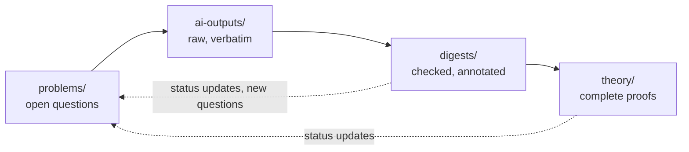

# Discrete k-nearest-neighbour graphs

*An open research project on percolation in lattice $k$-neighbour graphs, and on doing percolation theory without FKG and finite energy.*

Let every vertex of $\mathbb{Z}^d$ independently choose $k$ of its $2d$ nearest neighbours uniformly at random and connect to them. This simple rule defines a family of percolation models (directed, undirected, bidirectional, and XOR $k$-neighbour graphs) introduced in [[JKLT25](#ref-jklt25)] and studied further in [[CHJK24](#ref-chjk24)] and [[BJKLRT25](#ref-bjklrt25)]. Whether these graphs percolate is now known for most pairs $(k,d)$. Yet the degree constraint removes much of the standard machinery of percolation theory: there is no Harris–FKG inequality, no finite-energy property, no stochastic domination by Bernoulli percolation and no evident monotonicity in the dimension. Many natural questions are therefore open, and answering them calls for tools that do not depend on these properties.

The repository collects work on these questions in three layers:

1. **Raw AI outputs** (`ai-outputs/`): verbatim outputs of AI systems working on problems about these models, with full provenance.
2. **Digests** (`digests/`): human-checked digestions of these outputs: what is claimed, what is right, what is wrong, and what is worth keeping.
3. **Theory** (`theory/`): carefully proved results and techniques for percolation models in which the classical toolbox is not available.

Everyone is welcome to contribute, with or without AI tools. See [How to contribute](#how-to-contribute).

**Contents:** [The models](#the-models) · [What is known](#what-is-known) · [Claims under review](#claims-under-review) · [The toolbox problem](#the-toolbox-problem) · [Research directions](#research-directions) · [Repository layout](#repository-layout) · [Workflow](#workflow) · [How to contribute](#how-to-contribute) · [Credit, citation and licence](#credit-citation-and-licence) · [References](#references)

---

## The models

Fix $d\ge 1$ and $1\le k\le 2d$, and let $N_x=\lbrace y\in\mathbb{Z}^d : \lVert x-y\rVert_1=1\rbrace$ be the set of the $2d$ nearest neighbours of $x\in\mathbb{Z}^d$. Independently for every vertex $x$, let $S_x\subseteq N_x$ be a uniformly random subset with $k$ elements. For $y\in N_x$ the four graphs are:

| Graph | Short name | $x$ and $y$ are connected if |
|---|---|---|
| directed $k$-neighbour graph | $k$-DnG | $y\in S_x$ (directed edge from $x$ to $y$) |
| undirected $k$-neighbour graph | $k$-UnG | $y\in S_x$ or $x\in S_y$ |
| bidirectional $k$-neighbour graph | $k$-BnG | $y\in S_x$ and $x\in S_y$ |
| XOR $k$-neighbour graph | $k$-XnG | exactly one of $y\in S_x$ and $x\in S_y$ |

Let $\theta^{\ast}(k,d)$, $\ast\in\lbrace D,U,B,X\rbrace$, be the probability that the origin $o$ is the starting point of an infinite self-avoiding path (a directed path in the case of the DnG). The graph *percolates* if $\theta^{\ast}(k,d)>0$. For the directed graph one also studies in-percolation and strong percolation [[JKLT25](#ref-jklt25)]. The directed graphs are instances of the degenerate random environments of [[HS14](#ref-hs14)].

**A continuous parameter.** For $p\in[0,1]$ let $k=\lfloor 2dp\rfloor$ and $\varepsilon=2dp-k$. In the *$2dp$-neighbour graph* every vertex chooses $k$ neighbours uniformly at random and, independently with probability $\varepsilon$, one further neighbour uniformly among the remaining ones [[CHJK24](#ref-chjk24), [BJKLRT25](#ref-bjklrt25)]. Every directed edge is then present with probability $p$, and integer values of $2dp$ give back the $k$-neighbour graphs. The choices can be coupled so that they increase with $p$, so for $\ast\in\lbrace D,U,B\rbrace$ the critical parameter

```math
p_c^{\ast}(d)=\inf\lbrace p\in[0,1] : \theta^{\ast}_p(d)>0\rbrace
```

is well defined.

**Continuum relatives.** The analogous model in the continuum is the $k$-nearest-neighbour graph on a Poisson point process [[HM96](#ref-hm96), [BB13](#ref-bb13), [JT22](#ref-jt22)]. Heuristically, the lattice and continuum models should behave alike in high dimensions [[JKLT25](#ref-jklt25)].

---

## What is known

*Status as of October 2026. If something is missing or out of date, please open a pull request.*

**Directed and undirected graphs.** The DnG is contained in the UnG, so every positive result for the DnG also holds for the UnG.

- $k=1$: no percolation in any dimension, even for the undirected graph [[JKLT25](#ref-jklt25)].
- $k\ge d+1$: $\theta^D(k,d)=1$ [[JKLT25](#ref-jklt25)].
- Diagonal monotonicity: $\theta^D(k+1,d+1)\ge\theta^D(k,d)$ for all $k,d$ [[JKLT25](#ref-jklt25)].
- $d=2$: the 2-DnG percolates, and $0.3732\le p_c^D(2) < 1/2$ [[CHJK24](#ref-chjk24)]. By diagonal monotonicity the $d$-DnG percolates in $\mathbb{Z}^d$ for every $d\ge 2$.
- $k\ge 3$: the $k$-DnG percolates in every dimension $d\ge 2$ [[JKLT25](#ref-jklt25), [CHJK24](#ref-chjk24), [BJKLRT25](#ref-bjklrt25)].
- High dimensions: $p_c^D(d)\le p_c^{\mathrm{bond}}(d)$ for all $d$, and $2d\cdot p_c^D(d)\to 1$ as $d\to\infty$. In particular the 2-DnG percolates in all sufficiently large dimensions [[BJKLRT25](#ref-bjklrt25)].
- Open: $k=2$ in any specific dimension $d\ge 3$, for both the DnG and the UnG [[BJKLRT25](#ref-bjklrt25)]. A proof for every $d\ge 3$ is claimed in the raw AI output [`ai-outputs/2_NN_percolates/`](ai-outputs/2_NN_percolates/) (see [Claims under review](#claims-under-review)), and the preprint [arXiv:2610.38200](https://arxiv.org/abs/2610.38200) announces in its title that two-neighbour lattice percolation percolates in all dimensions. Neither has been digested yet.
- Simulations: $2d\cdot p_c^D(d)\approx 1.84,\ 1.38,\ 1.20$ for $d=2,3,4$ [[CHJK24](#ref-chjk24)].

**Bidirectional graph.**

- No percolation if $k(k-1) < 2d(2d-1)/c(d)$, where $c(d)$ is the connective constant of $\mathbb{Z}^d$ [[JKLT25](#ref-jklt25)]. This covers $k=2$ for $d\ge 2$, $k=3$ for $d\ge 3$ and $k=4$ for $d\ge 6$.
- Percolation if $k > 1.5834\cdot d$ [[JKLT25](#ref-jklt25)], and for all $k\ge 6$ in dimensions $4$ and $5$ [[BJKLRT25](#ref-bjklrt25)].
- High dimensions: $\sqrt{2d}\cdot p_c^B(d)\to 1$, so the critical $k$ grows like $\sqrt{2d}$ [[BJKLRT25](#ref-bjklrt25)].

**Comparison with other planar models.** At the same edge density, the 2-DnG percolates more easily than independent directed bond percolation, which in turn percolates more easily than the all-or-none model (each vertex opens all of its edges or none): $p_c^D(2) < 1/2 = p_c^{\mathrm{iid}}(2) < p_c^{\mathrm{aon}}(2)$ [[CHJK24](#ref-chjk24)]. More generally, degree constraints enhance percolation [[BJKLRT25](#ref-bjklrt25)].

---

## Claims under review

Claims from raw AI outputs that have not been digested yet. They do not count as results until a digest marks them `verified`.

**[`ai-outputs/2_NN_percolates/`](ai-outputs/2_NN_percolates/)**: a manuscript drafted with Claude (Anthropic), available as a [PDF](ai-outputs/2_NN_percolates/2_NN_percolates.pdf) together with its LaTeX sources, figures and code. No digest yet. It claims:

- The 2-DnG percolates in every dimension $d\ge 3$, with a bound that does not depend on $d$: $\theta^D(2,d)\ge\theta_2^{\mathrm{bond}}(13/25) > 0$, where $\theta_2^{\mathrm{bond}}(p)$ is the percolation probability of Bernoulli bond percolation on $\mathbb{Z}^2$. Combined with the results above, the $k$-DnG and the $k$-UnG then percolate if and only if $k\ge 2$, in every dimension, as conjectured in [[JKLT25](#ref-jklt25)].
- Rigorous computer-assisted upper bounds on $2d\cdot p_c^D(d)$ that decrease in $d$, from $1.834$ for $d=3$ to $1.130$ for $d=100$, and new simulated values for $5\le d\le 15$.

The proof represents each vertex of $\mathbb{Z}^{d-1}$ by a vertical column of $\mathbb{Z}^d$, tracks the avoidance probabilities of exchangeable laws through an explicit recursion, compares consecutive dimensions by an exact algebraic inequality, and concludes in the plane with the comparison principle of [[BJKLRT25](#ref-bjklrt25)] and Kesten's theorem.

---

[`ai-outputs/2026-11-01_claude-opus-5-5_critical-mean-outdegrees/`](ai-outputs/2026-11-01_claude-opus-5-5_critical-mean-outdegrees/): a manuscript drafted with Claude Opus 5.5 (Anthropic), *Critical mean out-degrees of directed, undirected and bidirectional lattice neighbour graphs*, with LaTeX sources, code and simulation data; timestamped on Zenodo, [doi:10.5281/zenodo.23859215](https://doi.org/10.5281/zenodo.23859215). Status: `unchecked`, no digest yet. In terms of $\beta=2dp$ it claims:

- $\beta_c^{B}(d)=\sqrt{2d}+1/2+O(d^{-1/2})$, with $\beta_c^{B}(d)\ge\sqrt{2d}+1/2$ for all $d\ge2$, and $2.6197\le\beta_c^{B}(2)<3$ (enhancement argument).
- $\beta_c^{D}(d)=1+1/(2d)+O(d^{-2})$ and $1+(1+o(1))/(8d^2)\le\beta_c^{U}(d)\le1+1/(2d)+O(d^{-2})$.
- Rigorous upper bounds on $\beta_c^{D}(d)$ for all $d\ge3$ from the column projection (for instance $\beta_c^{D}(3)\le1.834$, and $\beta_c^{D}(d)\le1.457$ for $d\ge9$), and the first comparisons between dimensions: $\beta_c^{D}(7)\le\beta_c^{D}(2)$ and $\beta_c^{D}(d)<\beta_c^{D}(2)$ for $d\ge8$.
- A sharp local comparison of the BnG and UnG with Bernoulli bond percolation for all $\beta$, and simulated values of all three critical curves for $2\le d\le10$.

The column projection overlaps with `ai-outputs/2_NN_percolates/` and with [LXZ26].


## The toolbox problem

Much of percolation theory rests on a few structural properties of Bernoulli percolation. The table records what becomes of them for $k$-neighbour graphs. Layer 3 of this project is about filling in the right-hand column.

| Tool | Status for $k$-neighbour graphs | Available instead |
|---|---|---|
| Harris–FKG inequality | **fails**: edges leaving the same vertex are negatively correlated | for integer $k$ the directed edge variables are negatively associated (sampling without replacement [[JDP83](#ref-jdp83)]) |
| Finite energy, insertion tolerance | **fails** for single edges: in the DnG every out-degree is exactly $k$ | vertex-wise resampling: given all other choices, $S_x$ is still uniform |
| Stochastic domination by Bernoulli percolation | **fails** in both directions [[BJKLRT25](#ref-bjklrt25)] | site-wise local-to-global comparison [[BJKLRT25](#ref-bjklrt25)] |
| Monotonicity in $d$ | **open**, and false in general | diagonal coupling $\theta^D(k+1,d+1)\ge\theta^D(k,d)$ [[JKLT25](#ref-jklt25)] |
| Planar duality | the dual model is not a $k$-neighbour graph | exploration, comparison with constrained Bernoulli percolation, enhancement [[CHJK24](#ref-chjk24)] |
| BK inequality | **holds** for increasing events when $k$ is an integer: the DnG is a product of $k$-out-of-$2d$ measures [[vdBJ12](#ref-vdbj12)], and this transfers to the UnG and BnG | for arbitrary events, BK–Reimer with disjointness measured in vertices, on the i.i.d. vertex choices [[Rei00](#ref-rei00)] |
| Russo's formula | no independent edge variables | between consecutive integer values of $2dp$, the parameter acts only through i.i.d. extra-edge coins, which gives a Russo-type formula in terms of pivotal vertices |
| Independence, ergodicity | edges sharing no vertex are independent | finite-range renormalisation with [[LSS97](#ref-lss97)]; the model is a factor of i.i.d. vertex variables |

---

## Research directions

The first three directions are the current focus. Each direction gets its own page in `problems/` with the precise statement, partial results, approaches tried (failed ones included) and links to the relevant raw outputs, digests and theory notes.

### P1 · Monotonicity in the dimension

For Bernoulli percolation, $p_c(d+1)\le p_c(d)$ is immediate because $\mathbb{Z}^d$ is a subgraph of $\mathbb{Z}^{d+1}$. For $k$-neighbour graphs this argument breaks down: a vertex of $\mathbb{Z}^{d+1}$ chooses among $2d+2$ neighbours, so the restriction to a $d$-dimensional slice is not a $k$-neighbour graph. Monotonicity is even false in general, because $\theta^D(k,d)=1$ for $d < k$ while $\theta^D(k,d) < 1$ for $d\ge k$ [[JKLT25](#ref-jklt25)].

- **Conjecture** [[JKLT25](#ref-jklt25)]: $\theta^D(k,d+1)\ge\theta^D(k,d)$ for all $2\le k\le d$. Together with [[CHJK24](#ref-chjk24)] this would show that the 2-DnG percolates in every dimension.
- Is $d\mapsto 2d\cdot p_c^D(d)$ non-increasing? The simulated values $1.84$, $1.38$, $1.20$ for $d=2,3,4$ suggest so [[CHJK24](#ref-chjk24)].
- Claimed in [`ai-outputs/2_NN_percolates/`](ai-outputs/2_NN_percolates/), no digest yet: rigorous upper bounds on $2d\cdot p_c^D(d)$ and simulated values for $5\le d\le 15$, both decreasing in $d$, and an explanation of why a single projection step from $\mathbb{Z}^{d+1}$ to $\mathbb{Z}^d$ cannot compare $p_c^D(d+1)$ with $p_c^D(d)$ directly.
- Known: diagonal monotonicity $\theta^D(k+1,d+1)\ge\theta^D(k,d)$, proved by a coupling [[JKLT25](#ref-jklt25)].

### P2 · A shape theorem for the directed 2-neighbour graph in the plane

The 2-DnG on $\mathbb{Z}^2$ percolates [[CHJK24](#ref-chjk24)]. On the event that the forward cluster of the origin is infinite, let $R_n$ be the set of vertices that can be reached from $o$ by a directed path with at most $n$ steps. Does $n^{-1}R_n$ converge to a deterministic shape, and what does that shape look like?

Natural intermediate steps are linear growth of $R_n$, a time constant in each direction, and a description of the geometry of the forward cluster itself. Useful points of comparison are the shape theorem for forward clusters in the orthant model [[HS21](#ref-hs21)] and shape theorems for the chemical distance on the Bernoulli cluster [[GM04](#ref-gm04)]. The obstacles are the usual ones for this project: there is no FKG inequality, reachability is not symmetric, and, as already in [[HS21](#ref-hs21)], the quantities one would like to feed into a subadditive ergodic theorem are not stationary.

### P3 · Sharpness of the phase transition

Use the continuous parameter of the $2dp$-neighbour graph. Is the phase transition sharp? That is, does the one-arm probability $\mathbb{P}_p(o\leadsto\partial B_n)$ decay exponentially in $n$ for every $p < p_c^{\ast}(d)$, and is $\theta^{\ast}_p(d)\ge c\cdot(p-p_c^{\ast}(d))$ for $p > p_c^{\ast}(d)$?

The classical proofs (Menshikov, Aizenman–Barsky, Duminil-Copin–Tassion, and the OSSS approach of [[DRT19](#ref-drt19)]) use the independence of edges, the FKG inequality or monotonicity of the measure, none of which is available here; the BK inequality, on the other hand, holds for integer $k$ [[vdBJ12](#ref-vdbj12)]. Known partial results are exponential decay whenever the model lies strictly below a non-percolating model in the site-wise comparison of [[BJKLRT25](#ref-bjklrt25)], and stretched-exponential tail bounds for dual forward clusters in $d=2$ [[CHJK24](#ref-chjk24)]. Since the model is a factor of i.i.d. vertex variables, the OSSS inequality applies directly. The difficulty is to compare the influence of a vertex, which includes re-choosing its neighbours, with the derivative in $p$, which only sees whether the vertex adds one more neighbour.

### Further directions

- **$k=2$ in dimensions $d\ge 3$.** Percolation is known for $d=2$ and for all sufficiently large $d$. A proof for every $d\ge 3$ is claimed in [`ai-outputs/2_NN_percolates/`](ai-outputs/2_NN_percolates/); digesting it has priority (see [Claims under review](#claims-under-review)).
- **Bidirectional graphs in low dimensions.** Close the gap between the two criteria for the BnG above in small dimensions. For example, does the 3-BnG percolate in $d=2$? It is conjectured to [[JKLT25](#ref-jklt25)].
- **XOR graphs, in-percolation and strong percolation.** [[JKLT25](#ref-jklt25)] conjectures, for example, that the 2-XnG percolates if and only if $d\ge 3$, and that in-percolation occurs if and only if out-percolation does.
- **Does less variability help percolation?** For planar models with the same edge density, [[CHJK24](#ref-chjk24)] conjectures that the critical points increase in the order: straight pairs (north-south or east-west), the 2-neighbour graph, corner pairs, independent edges, all-or-none. Which notion of variability explains this ordering?
- **Numerics and rigorous bounds** for $p_c^D(d)$, $p_c^U(d)$ and $p_c^B(d)$ in small dimensions.

---

## Repository layout

```text
.
├── README.md
├── problems/       one page per research direction: statement, status, links
├── ai-outputs/     (1) raw AI outputs: verbatim, immutable, with metadata
├── digests/        (2) human-checked digestions of AI outputs
├── theory/         (3) LaTeX notes with complete proofs
│   └── toolbox/        substitutes for FKG, finite energy, ...
├── simulations/    code and data for numerical experiments
├── literature/     references.bib and reading notes
└── templates/      templates for raw outputs, digests and problem pages
```

---

## Workflow

Material moves from left to right, and only checked mathematics reaches `theory/`.



### 1. Raw AI outputs (`ai-outputs/`)

Every run gets its own folder in `ai-outputs/`, for example `ai-outputs/YYYY-MM-DD_<model>_<topic>/`, containing

- the complete output, exactly as produced: `output.md` for a chat transcript (for multi-turn sessions, the full transcript), or all files the model wrote, such as LaTeX sources, figures and code, together with the compiled PDF (see `ai-outputs/2_NN_percolates/`);
- `prompt.md`: the complete prompt, including any system prompt or custom instructions, and a list of all files given to the model;
- `meta.yml`: the provenance of the run.

```yaml
date: 2026-10-30
contributor: Full Name (@github-handle)
model: exact model name and version
interface: chat, API or agent; tools enabled (search, code execution, ...)
settings: reasoning mode, temperature, etc., if known
context: papers and notes supplied to the model
problem: P2          # the page in problems/ this run belongs to
digests: []          # filled in once the output has been digested
```

Rules:

- **Verbatim and complete.** Do not edit, shorten or cherry-pick. Failed and wrong attempts are useful data. Format conversions (for example to Markdown) are fine as long as the content is unchanged.
- **Immutable.** Once merged, a raw output is not changed. Corrections belong in a digest.
- **Not a source of truth.** A raw output is never cited as a result.
- **Respect other people's work.** Do not put unpublished work of others (manuscripts, referee reports, private communications) into prompts or into this repository without their permission.
- **Check the terms.** Make sure the AI provider's terms allow you to share the output under the licence of this repository.

### 2. Digests (`digests/`)

A digest is written by a person, who may use AI assistance but must say so. It refers to one or more raw outputs and contains:

- the claims of the output, restated precisely in the notation of this README;
- a claim-by-claim check, each claim with a status label (see below);
- errors and gaps, with counterexamples where possible;
- the ideas worth keeping and their relation to the literature (is this already known?);
- the name of the checker and the date.

AI-generated arguments about these models tend to fail in the same places. Check in particular for

- silent use of Harris–FKG or of other positive-correlation inequalities;
- local modifications of single edges (insertion tolerance, finite energy);
- edges at the same vertex treated as independent, or facts specific to Bernoulli percolation (such as $p_c=1/2$ for bond percolation on $\mathbb{Z}^2$);
- monotonicity in the dimension justified by $\mathbb{Z}^d\subset\mathbb{Z}^{d+1}$;
- directed and undirected connectivity, or forward and backward clusters, being mixed up.

### 3. Theory (`theory/`)

- Proofs are written in LaTeX, one document per topic, with a shared macro file `theory/macros.tex` for consistent notation. Problem pages, digests and short notes are written in Markdown with GitHub's math support.
- A statement enters `theory/` only with a complete proof that has been checked line by line by at least one contributor other than the person who wrote it up. The checker is named in the document.
- If an idea comes from a raw output or a digest, cite it by its path in the repository.
- `theory/toolbox/` collects general-purpose substitutes for missing tools: one document per tool, with statement, proof, scope and known applications. Everything else is organised by problem.

### Status labels

| Label | Meaning |
|---|---|
| `unchecked` | nobody has checked it yet |
| `verified` | checked line by line by the person named |
| `gap` | the argument has an identified gap; the claim may still be true |
| `false` | wrong, with an explanation or counterexample |
| `known` | correct, but already in the literature (give the reference) |

---

## How to contribute

1. **Discuss.** Open an issue for a concrete claim, question or proposed problem. Use Discussions for brainstorming and coordination.
2. **Add raw outputs.** One pull request per run (or per batch of closely related runs) into `ai-outputs/`, using the template.
3. **Digest.** Pick an output whose `meta.yml` lists no digests yet and write one. Anyone may digest anyone's output.
4. **Prove.** Write up checked results in `theory/`, and update the status on the corresponding problem page.

Please keep pull requests small and focused on one topic.

**Good first contributions**

- Help digest [`ai-outputs/2_NN_percolates/`](ai-outputs/2_NN_percolates/): check one of the lemmas in Section 4 of the [manuscript](ai-outputs/2_NN_percolates/2_NN_percolates.pdf), or re-run the exact computations in `code/exact_all.py`, `code/rig_table.py` and `code/star_identity.py`.
- Digest another raw output, or re-check a claim labelled `unchecked`.
- Write the page in `problems/` for one of the research directions.
- Run simulations, for example to estimate $p_c^D(3)$ or to test monotonicity in $d$ numerically.
- Take a classical proof and mark every step that uses FKG, finite energy or independence of edges. Such annotated proofs are the starting point of the toolbox.

**Using AI tools well**

- Give the model the precise definitions (the [models section](#the-models) can be copied verbatim) and the relevant papers.
- Ask it to name every tool it uses and to justify each one for this model, in particular any use of FKG or finite energy.
- Ask for sanity checks in degenerate cases, such as $d=1$ or $k=2d$, and for counterexamples to its own claims.
- Commit every run, including those that led nowhere.

---

## Credit, citation and licence

**Credit.** All contributions are recorded in the git history and in `CONTRIBUTORS.md`. AI systems are acknowledged by name and version wherever their output is used, but they are not authors. How results will be written up and credited is agreed openly in the Discussions before anything is submitted for publication (if ever). 

**Citation.** If you use material from this repository, please cite the original papers below and link to the repository, for example:

```bibtex
@misc{discrete-knn-graphs,
  title        = {Discrete $k$-nearest-neighbour graphs: a community research project},
  author       = {{Contributors to the discrete k-nearest-neighbour graph project}},
  year         = {2026},
  howpublished = {\url{https://github.com/jonaskoeppl/percolation-discrete-knn}}
}
```

**Licence.** Text, notes and proofs are licensed under [CC BY 4.0](https://creativecommons.org/licenses/by/4.0/); code, in particular in `simulations/`, under the [MIT License](https://opensource.org/license/mit). By contributing you agree that your contribution is licensed under these terms.

**Contact.** The project was initiated by Benedikt Jahnel (TU Braunschweig) and Jonas Köppl (Uni Münster). Please use the issue tracker or the Discussions for questions.

---

## References

**The three papers this project builds on**

- <a id="ref-jklt25"></a>**[JKLT25]** B. Jahnel, J. Köppl, B. Lodewijks, A. Tóbiás. Percolation in lattice $k$-neighbor graphs. *J. Appl. Probab.* 62(4):1475–1492, 2025. [doi:10.1017/jpr.2025.15](https://doi.org/10.1017/jpr.2025.15) · [arXiv:2306.14888](https://arxiv.org/abs/2306.14888)
- <a id="ref-chjk24"></a>**[CHJK24]** D. Coupier, B. Henry, B. Jahnel, J. Köppl. The planar lattice two-neighbor graph percolates. Preprint, 2024. [arXiv:2412.20781](https://arxiv.org/abs/2412.20781)
- <a id="ref-bjklrt25"></a>**[BJKLRT25]** J. Bäumler, B. Jahnel, J. Köppl, B. Lodewijks, L. Reeves, A. Tóbiás. Local criteria for global connectivity comparisons: beyond stochastic domination. Preprint, 2025. [arXiv:2510.03934](https://arxiv.org/abs/2510.03934)

**Continuum $k$-nearest-neighbour graphs and related models**

- <a id="ref-bb13"></a>**[BB13]** P. Balister, B. Bollobás. Percolation in the $k$-nearest neighbor graph. In *Recent Results in Designs and Graphs: A Tribute to Lucia Gionfriddo*, Quaderni di Matematica 28:83–100, 2013.
- <a id="ref-hm96"></a>**[HM96]** O. Häggström, R. Meester. Nearest neighbor and hard sphere models in continuum percolation. *Random Structures Algorithms* 9:295–315, 1996.
- <a id="ref-hs14"></a>**[HS14]** M. Holmes, T. S. Salisbury. Degenerate random environments. *Random Structures Algorithms* 45:111–137, 2014.
- <a id="ref-hs21"></a>**[HS21]** M. Holmes, T. S. Salisbury. A shape theorem for the orthant model. *Ann. Probab.* 49:1237–1256, 2021.
- <a id="ref-jt22"></a>**[JT22]** B. Jahnel, A. Tóbiás. Absence of percolation in graphs based on stationary point processes with degrees bounded by two. *Random Structures Algorithms* 62:240–255, 2022.

**Classical tools**

- <a id="ref-bk89"></a>**[BK89]** R. M. Burton, M. Keane. Density and uniqueness in percolation. *Comm. Math. Phys.* 121:501–505, 1989.
- <a id="ref-drt19"></a>**[DRT19]** H. Duminil-Copin, A. Raoufi, V. Tassion. Sharp phase transition for the random-cluster and Potts models via decision trees. *Ann. of Math.* 189:75–99, 2019.
- <a id="ref-gm04"></a>**[GM04]** O. Garet, R. Marchand. Asymptotic shape for the chemical distance and first-passage percolation on the infinite Bernoulli cluster. *ESAIM Probab. Stat.* 8:169–199, 2004.
- <a id="ref-jdp83"></a>**[JDP83]** K. Joag-Dev, F. Proschan. Negative association of random variables with applications. *Ann. Statist.* 11:286–295, 1983.
- <a id="ref-lss97"></a>**[LSS97]** T. M. Liggett, R. H. Schonmann, A. M. Stacey. Domination by product measures. *Ann. Probab.* 25:71–95, 1997.
- <a id="ref-rei00"></a>**[Rei00]** D. Reimer. Proof of the van den Berg–Kesten conjecture. *Combin. Probab. Comput.* 9:27–32, 2000.
- <a id="ref-vdbj12"></a>**[vdBJ12]** J. van den Berg, J. Jonasson. A BK inequality for randomly drawn subsets of fixed size. *Probab. Theory Related Fields* 154:835–844, 2012.
